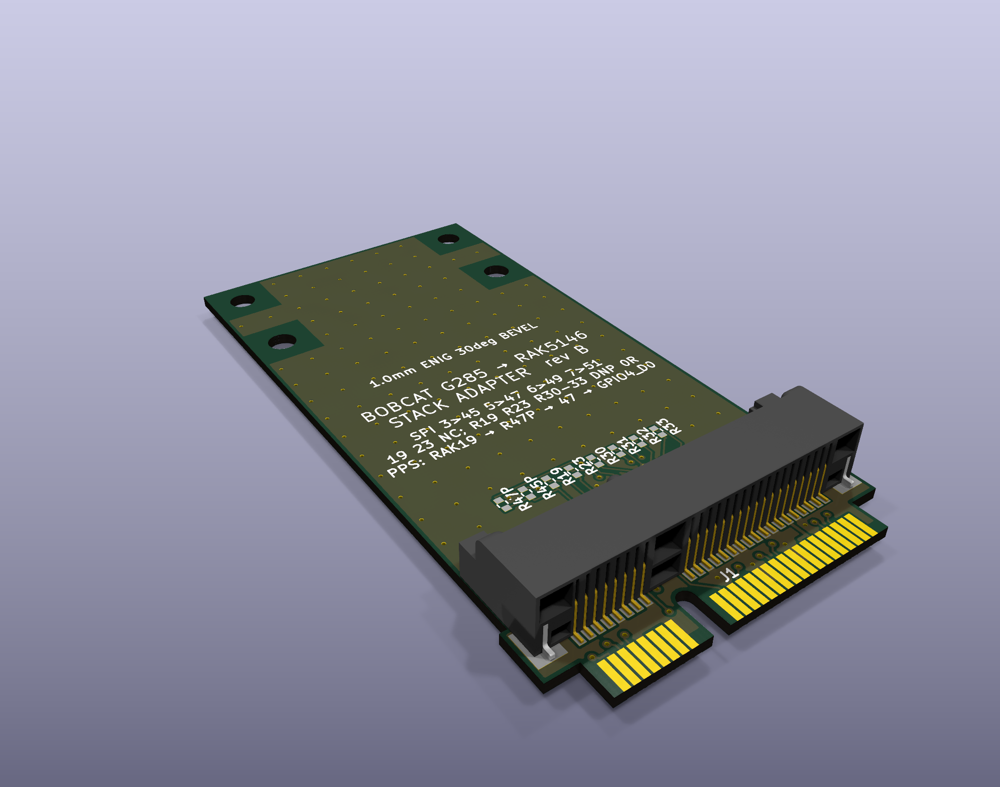

# bobcat-300

Repurposing the **Bobcat Miner 300** (board **G285-V1.0**, Rockchip **RK3566**, mini-PCIe LoRa concentrator) from a
Helium hotspot into an open, hackable LoRa node for **time transfer** experiments, the goal being two-way LoRa
time transfer between nodes, validated against GNSS PPS.

*The [stack adapter](stack-adapter/): plugs into the G285 concentrator socket and carries a RAK5146 (SX1303 + GPS) on top.*

Everything here is fact-checked. Every claim in `docs/` ends with a tag:

- **[VERIFIED: source]**: checked against a primary source (code, device tree, datasheet, logic-analyzer capture, meter
  reading or command output, named in the tag)
- **[UNVERIFIED: origin]**: from notes, community pages or inference, not yet confirmed
- **[CONTRADICTED: what disagrees]**: sources disagree; both sides recorded

Each doc ends with a *Contradictions & open questions* section. Corrections are welcome (open an issue with evidence).

## Contents

| Doc | What it covers |
|---|---|
| [docs/os-boot-gpio.md](docs/os-boot-gpio.md) | Armbian on SD (eMMC untouched), boot chain and boot-script gotchas, 1.5 Mbaud debug console, Ethernet (YT8512B) and Wi-Fi quirks, radio power/reset GPIOs, SPI1, SARADC, broken DT nodes, RTC, PTP |
| [docs/bare-metal-rust.md](docs/bare-metal-rust.md) | Bare-metal Rust image for the RK3566 (QEMU-tested), the carved-core-3 Rust PPS engine that runs on hardware, the deployed Linux time-transfer logger, measured results and lessons |
| [docs/gnss-populate.md](docs/gnss-populate.md) | The unpopulated u-blox NEO-footprint GNSS site: pinout, parts to fit and where, antenna path, PPS routing, beep-test results, install plan, risks |
| [docs/socket-pinout-rak5146.md](docs/socket-pinout-rak5146.md) | The **non-standard** concentrator socket pinout (proven with a logic analyzer), why a RAK5146 reads `0xFF` in a stock G285, and the interposer spec |
| [stack-adapter/](stack-adapter/) | **Rev B:** Mini Card-sized stack adapter that lets a RAK5146 (SX1303 + GPS) run in the G285 socket; the RAK stacks right on top (routed, DRC-clean review release) |
| [interposer-rev-a/](interposer-rev-a/) | Rev A breakout interposer (50 × 109.5 mm, superseded by the stack adapter) |
| [tools/](tools/) | Small scripts used for the work (see below) |

## Key facts at a glance

- **Concentrator socket SPI (G285):** SCK = **3**, MISO = **5**, MOSI = **6**, CS = **7**. A RAK2287/RAK5146-style card
  expects 45/47/49/51, so it cannot talk in a stock G285 without rerouting. Power (2/24/39/41/52) and ground match.
- **Radio control GPIOs (Linux sysfs numbers on the Armbian 6.18 image):** 125 = GPIO3_D5 RF enable, 122 = GPIO3_D2 power,
  149 = GPIO4_C5 reset. SPI1 (`spi1m1`) → `/dev/spidev1.0`.
- **Debug console:** UART2 at **1,500,000 baud** (not 115200).
- **Stock card:** N3504S (SX1302 + 2× SX1250). SX1302 has no fine timestamp; SX1303 (e.g. RAK5146) does.
- **GNSS:** an empty 24-pad u-blox NEO footprint whose TIMEPULSE pad reaches socket pin 19 through an unfitted resistor.
  **Do not bridge it if a RAK5146 is fitted**, because its GPS drives pin 19 itself.

## Tools

| File | Purpose |
|---|---|
| `tools/reset_lgw.sh` | Radio power/reset sequence for the G285, matching the stock firmware (used by Semtech `sx1302_hal`) |
| `tools/hal-bobcat.patch` | `sx1302_hal` V2.1.0 patch: runs without the STTS751 temperature sensor the G285 lacks, and prints the chip model (SX1302 vs SX1303) |
| `tools/pinscan.py` | Read-only GPIO input scanner (reads each bank's input register via `/dev/mem`) to map pads to SoC pins |
| `tools/stim.py` | Logic-analyzer stimulus: SPI1 test pattern bursts plus a slow reset toggle |
| `tools/chiploop.sh` | Repeated `chip_id` reads for capturing live MISO traffic |

## Safety

- Work with the stock eMMC untouched: boot Armbian from SD. Pull the card to get the stock firmware back.
- The concentrator can transmit at up to 27 dBm. Keep an antenna or load attached, and observe your local regulations.
- Socket tails are 0.8 mm pitch. Power off before probing with anything that can bridge pins.

## Credits and references

- Armbian image for the G285: sicXnull/Bobcat-Armbian.
- Community pinout reference: helium-repurposed.deobfuscated.org, *Devices / Bobber / Bobcat Miner 300*.
- Semtech `sx1302_hal`; RAKwireless RAK5146 datasheet; u-blox NEO-M8 datasheet and hardware integration manual.

## License

MIT (see [LICENSE](LICENSE)), except `tools/hal-bobcat.patch`, which modifies Semtech's `sx1302_hal` and stays under
Semtech's Revised BSD License.
