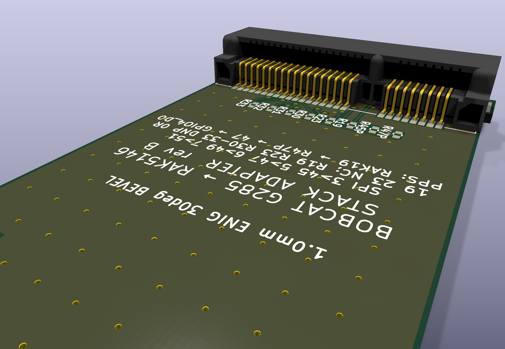
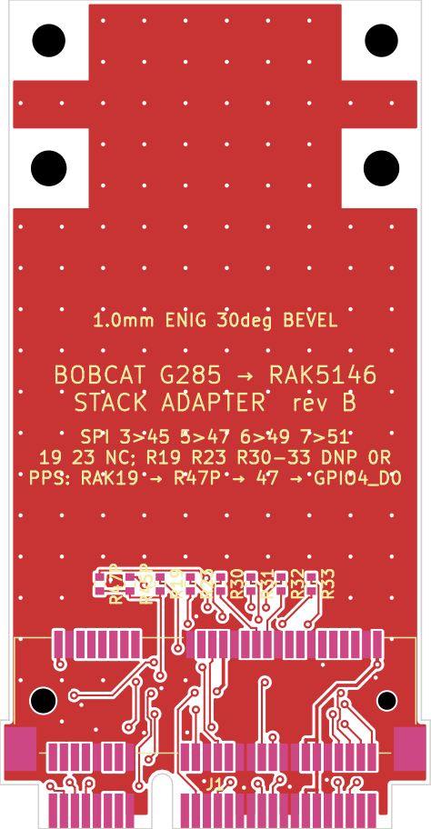
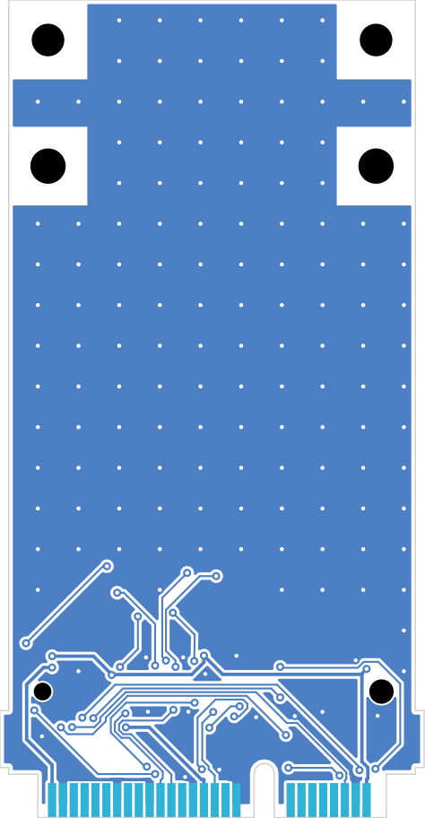

# G285 → RAK5146 stack adapter (rev B)

**Status: routed and KiCad-DRC-clean (review release, 2026-10-22). Not yet fabricated or tested; check everything before ordering.**

A Mini Card-sized stack adapter. Its gold fingers plug into the Bobcat G285 concentrator socket. A mini-PCIe socket sits on
top, right behind the fingers, so the RAK5146 card lies directly above the adapter, over the Bobcat's own card area. There is
no breakout and no jumper field. Rev A, the large breakout interposer, is in [../interposer-rev-a/](../interposer-rev-a/).

| Socket close-up | Top copper | Bottom copper |
|---|---|---|
|  |  |  |

## Why

The G285 socket carries SPI on pins 3/5/6/7. RAK's cards expect it on 45/47/49/51. The pinout was proven with a logic
analyzer; see [../docs/socket-pinout-rak5146.md](../docs/socket-pinout-rak5146.md).

## Electrical

| Bobcat (fingers) | RAK5146 (socket J1) | Treatment |
|---|---|---|
| 3 SCK | 45 | rerouted (short traces near the fingers and the socket) |
| 5 MISO | 47 | rerouted |
| 6 MOSI | 49 | rerouted |
| 7 CS | 51 | rerouted |
| 2, 24, 39, 41, 52 | same | 3.3 V, all tied, 0.25 mm traces |
| 4, 9, 15, 18, 21, 26, 27, 29, 34, 35, 37, 40, 43, 50 | same + socket tabs | GND, routed plus F/B pours, 141 stitching vias |
| 22 | 22 (RAK reset, active high) | straight through (sits low = RAK running) |
| 19 | 19 (RAK GPS PPS out) | **not connected.** DNP 0R option R19 |
| 23 | 23 (RAK GPS reset in) | **not connected.** DNP 0R option R23 |
| 30, 31, 32, 33 | same (RAK GPS I2C / UART) | not connected. DNP 0R options R30–R33 |
| everything else | — | not connected on either side |

The options are 0402 0R links (UNI-ROYAL 0402WGF0000TCE, LCSC C17168), fitted by hand if a GPS signal is wanted later.
Each option's pad 1 goes to the Bobcat finger and pad 2 to the RAK socket pin of the same number.

## Mechanical (all distances from the finger edge)

| Item | Value | Source |
|---|---|---|
| Outline | **60.30 × 30.00 mm**, 31.30 mm across the socket-tab ears | this design |
| Thickness / fingers | 1.0 mm, contacts 0.60 × 2.55 on 0.80, odd contacts on top (verified on a real card) | PCI-SIG Mini CEM 1.2 |
| Bobcat hold-down holes | Ø2.6 at **48.05**, x ±12.10 | Mini CEM fig 2-3 |
| RAK socket J1 | SOFNG PCIE-52P52H (LCSC C444927), top side | |
| J1 card-edge line (where the RAK card's edge seats; the socket's peg line) | **9.30** | footprint + Mini CEM host-socket datum |
| J1 front (odd-row pads, solder tabs) | **4.20** | ≥ the fig 2-7 top keep-out: 3.20, or 4.20 at the key (4.20 applied across the full width) |
| RAK standoff holes | Ø2.4 NPTH at **57.35** (9.30 + 48.05), x ±12.10 | Mini CEM fig 2-3 |
| RAK card far end | 9.30 + 50.95 = **60.25** | |
| Hold-down keep-outs | 5.8 × 5.8 mm, all layers, at every hole | Mini CEM fig 2-7 |
| Bottom side | flat: no components, fingers + routing + GND only | |

**Fit inside the G285.** The space measured past a stock card is 17 mm, so the stack must end within 50.95 + 17 = 67.95 mm of
the finger edge. Both seating depths are already in the numbers above:

- The adapter's fingers seat in the Bobcat socket exactly like the stock card. The 48.05 mm hold-down distance is measured
  from that same seated edge, so there is no offset.
- The RAK card's edge seats in J1 at the card-edge line, 9.30 mm. Its first few mm are inside the J1 body, and it ends at
  9.30 + 50.95 = 60.25 mm.

The stack therefore ends at **60.30 mm** (the outline; the RAK card at 60.25). That is 9.35 mm past a stock card, and 7.65 mm
inside the 67.95 mm limit.

**Heights.**

- J1 holds the RAK card plane at 3.25 mm, so the card's underside is 2.75 mm above the adapter.
- RAK standoffs: **M2, 2.75 mm** (or a 2.5 mm M2 SMT/press standoff plus a 0.25 mm washer).
- The Bobcat hold-down screws at 48.05 sit under the RAK card. An M2 pan or wafer head of ≤ 1.6 mm clears the 2.75 mm gap.
- J1's two plastic pegs (Ø1.8 / Ø1.3 NPTH at 9.30) poke ~0.6 mm out of the bottom. Check them against the G285 board under
  the card; trim them flush if they touch.
- No Z conflict with the Bobcat socket. Its housing lip covers the card only inside the 3.2 / 4.2 mm keep-out band, and J1
  starts at 4.20 mm, so the two never overlap in plan view.

**Paper fit check.** Print [renders/bobcat-rak-stack-adapter-1to1-fitcheck.pdf](renders/bobcat-rak-stack-adapter-1to1-fitcheck.pdf)
at 100% (A4 page) and confirm that the bar reads 50.00 mm. The page has the outline, holes, J1 footprint and courtyard, and
the dimensions above as text. Also check the 0.65 mm ears at 3.70–7.90 mm from the edge against the Bobcat socket's side
latches.

## Fabrication: JLCPCB gold fingers on a 30 mm card

JLCPCB does not accept a board this size with gold fingers as a single board:

- The length and width of a single board **or panel** with gold fingers must each be ≥ 50 mm, and chamfers are not offered under 5 × 5 cm.
- Fingers on a V-cut panel cannot be bevelled (the fingers end up mid-panel).
- With a 30° bevel and 0.5 mm remaining edge thickness on a 1.0 mm board, the bevel reaches L = (1.0/2 − 0.5/2)/tan 30° ≈ 0.43 mm
  in. JLCPCB's CAM cuts back up to 0.6 mm of copper there. The board keeps a 1.0 mm no-copper strip except the fingers.

Sources: [JLCPCB: gold fingers](https://jlcpcb.com/help/article/jlcpcb-gold-fingers),
[JLCPCB order FAQ: gold fingers](https://jlcpcb.com/quote/pcbOrderFaq/Gold%20Fingers).

**Recommended: a 2-up panel, tab-routed.** Place two boards side by side, fingers flush on one outer (bottom) edge of the panel.
Join them with mouse-bite tabs on the long sides only, with no V-cut and no rail on the finger edge. A 2 mm gap gives about
64.6 × 60.3 mm, which clears 50 × 50. Order it as panel-by-customer:

- 2 layers, 1.0 mm, ENIG
- gold fingers yes, 30° bevel
- no V-cut

That gets real hard-gold-plated, bevelled fingers. **This panel is not built yet**: `gerber_check` therefore fails `outline`
on the single board (31.4 × 60.4 mm < 50 × 50), by design. Every other check passes.

**Fallback.** Order the single board with ENIG and without the gold-finger option, then chamfer the finger edge by hand
(file or sandpaper, 30°). ENIG is thin, so expect fewer good insertions, which is fine for a bench part.

## Design status (2026-10-22)

The design starts in a tscircuit-based board pipeline (pcb-factory, board `bobcat-rak-stack-adapter`, branch
`bobcat-rak-interposer`). It is finished in KiCad by scripts, never by mouse; the scripts are in `pipeline/`:

1. `fix_export.py` repairs the tscircuit → KiCad export:
   - the even fingers go back to B.Cu, and the thickness is set to 1.0 mm
   - GND pours, the bevel strip and the hold-down keep-outs are added
   - part data and DNP flags are set, the holes become MH1–MH4, and the J1 silk is kept off the edge
   - the 3D model goes on J1, and the scale bar and dimension notes go on the fit-check page
2. `kicad_to_dsn.py` writes the Specctra DSN. Settings:
   - 0.6/0.3 vias
   - signal 0.14 mm, clearance 0.13 mm, 3V3 0.25 mm
   - via-to-via and peg keep-outs sized so drills stay ≥ 0.5 mm apart
3. Freerouting 2.4.1 (150 passes) produced **0 unrouted** (`pipeline/freerouting.log`). Wider clearances or a 0.3 mm power
   trace left 1–8 nets unroutable, and that is why the rules are what they are.
4. `ses_to_kicad.py` imports the routes, clamping one neck-down wire to the 0.13 mm minimum.
5. `space_vias.py` moved one B31 via 0.04 mm to restore 0.5 mm drill spacing.
6. `stitch_gnd.py` places 141 stitching vias (grid, then targeted fragments, then a prune of floating ones). Zone refills are
   done by `kicad-cli` between passes.
7. `run_pipeline.sh` runs steps 4–6; `export.sh` makes the package.

Results:

- **KiCad DRC (kicad-cli 10.0.4): 0 errors, 0 unconnected.**
  - The 52 `copper_edge_clearance` findings are on the finger pads only. They are exempted and itemised by the fab profile's
    named `card_edge` override.
  - 13 `lib_footprint_issues` warnings remain: the exported footprints are not from a KiCad library.
- **gerber_check (jlcpcb-2layer-cardedge): all pass except `outline`** (see Fabrication). The values:
  - 2 copper layers
  - min drill 0.30 mm (178 holes)
  - closest drill pair 0.516 mm (limit 0.50)
  - drill to edge 1.4 mm
  - no orphan paste
  - min aperture 0.14 mm
- **Factory loop.** Every hard gate passes (DRC, open nets, staleness). The loop stops on the soft gate
  `completeness ≥ 3.0` (Jev 2.97) with `edit_source` and names no defect, the same as rev A. It is **not export_ready**, and the
  fab zip here was made with kicad-cli directly and is marked REVIEW. Nothing has been ordered or uploaded.
- Routing: 326 track segments, 46 routed vias, 141 GND stitching vias.

## Files

- `kicad/`: the KiCad 10 project (`bobcat-rak-stack-adapter.kicad_pcb` / `.kicad_pro` / `.kicad_sch`, the factory's source
  for this board). It also holds `3dmodels/PCIE-52P52H_C444927.step`, the SOFNG socket model from EasyEDA/LCSC.
- `fab/`:
  - `bobcat-rak-stack-adapter-REVIEW-gerbers.zip`: Gerbers, PTH/NPTH Excellon and drill maps, single board, not panelised
  - the KiCad DRC and gerber_check JSON
  - BOM and CPL: J1 is the only populated part; the six 0R options are DNP. **Check J1's rotation in JLCPCB's placement
    preview**, because EasyEDA-derived parts often need a 180° correction.
- `renders/`:
  - 3D views (iso, top, bottom, a socket close-up)
  - flat top/bottom copper and the schematic (SVG + PNG)
  - the 1:1 fit-check PDF
- `pipeline/`: the scripts above, `index.tsx` (the board source as committed in pcb-factory) and the Freerouting log. To
  rebuild:
  1. Put the exported `bobcat-rak-stack-adapter.kicad_*` in a work dir next to the scripts.
  2. `run_pipeline.sh dsn`
  3. Run Freerouting on `fixed.dsn` to make `fixed.ses`.
  4. `run_pipeline.sh`
  5. `export.sh` (it writes to the parent of the work dir).

## Assembly order

1. Solder J1 (or have JLCPCB place it). Leave R19/R23/R30–R33 empty.
2. Fit two M2 × 2.75 mm standoffs at the RAK holes (57.35 mm).
3. Plug the adapter into the G285 socket and screw it down at 48.05 mm with low-head M2 screws.
4. Insert the RAK5146 into J1 at an angle, press it down onto the standoffs and screw it down.
5. Run `chip_id`; expect a real version byte, not `0xFF`.
